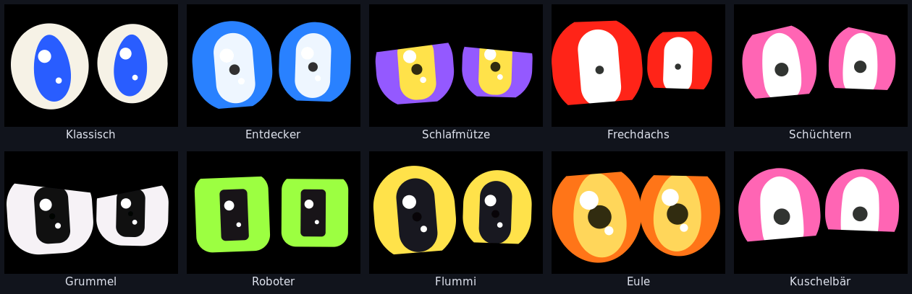
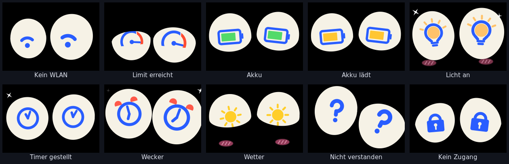
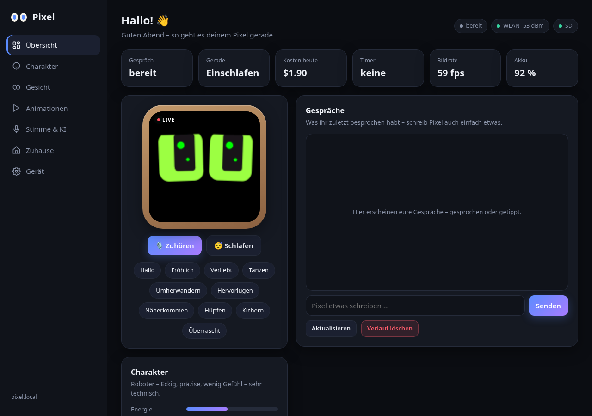
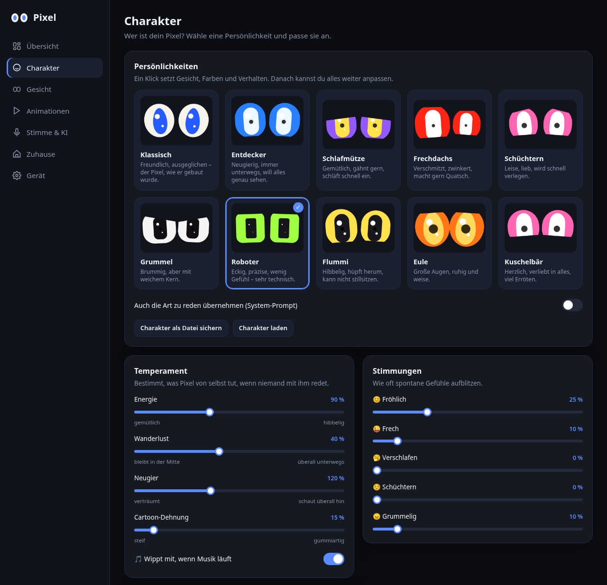
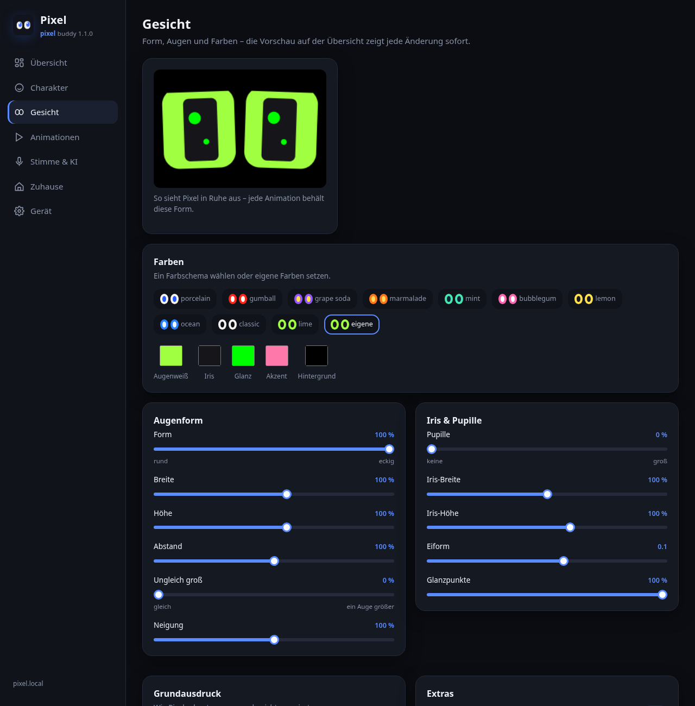
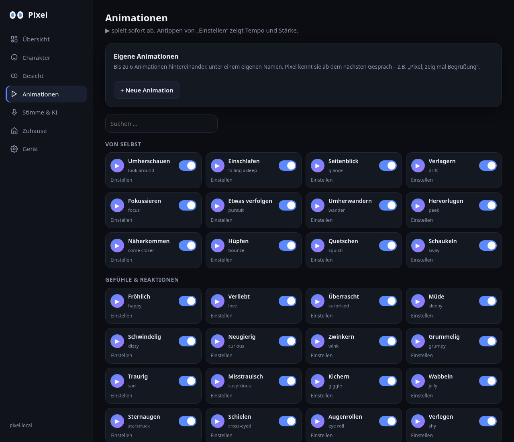

<b>Der kleine Freund mit großen Augen.</b>

# Pixel Buddy – animierte Augen mit Sprachassistent

Firmware für das Spotpear ESP32-S3 „muma“ Board (1,54″-Display 240×240 mit Touch, Mikrofon, Lautsprecher,
microSD). Pixel hat selbst gerenderte Augen, hört auf „Pixel“ (eigenes Netz, offline) und redet live über
OpenAI (GPT-Live oder die Realtime API).

Alle Bilder der Augen kommen aus dem Simulator (`sim/`), der denselben Renderer benutzt wie das Display.

**Zehn Persönlichkeiten** – Gesicht, Farben und Verhalten auf einen Klick, danach alles einzeln einstellbar:

**Symbole in den Augen** – WLAN, Nutzungslimit, Akku, Lampen, Timer, Wecker, Wetter, Rückfragen:

**Webinterface** (http://pixel.local) – Live-Vorschau, Charakter, Gesicht, Animationen, Stimme & KI, Zuhause, Gerät:

| Übersicht | Charakter |
|---|---|
|  |  |
| **Gesicht** | **Animationen** |
|  |  |

## Installieren

**Fertige Firmware:** unter [Releases](../../releases) – `pixel.bin` (komplette Installation, z.B. mit der
Installationsseite aus `tools/dist.sh` oder `esptool.py write_flash 0x0 pixel.bin`) und `pixel-update.bin`
(Update über WLAN im Webinterface).

**Ohne Entwicklungsumgebung:** `tools/dist.sh` erzeugt in `dist/` eine fertige Firmware ohne private
Zugangsdaten und eine Installationsseite. Den Ordner per https veröffentlichen (z.B. GitHub Pages) oder lokal
`cd dist && python3 -m http.server 8000` → http://localhost:8000 in Chrome/Edge, Board per USB anschließen,
„Installieren“.

**Mit PlatformIO:** `pio run -t upload`. Optional `src/secrets.example.h` nach `src/secrets.h` kopieren und
WLAN + OpenAI-Key eintragen, dann entfällt die Einrichtung.

## Einrichtung

Ohne eingerichtetes WLAN öffnet Pixel ein eigenes WLAN „Pixel-Setup-XXXX“ und zeigt dafür einen QR-Code.
Mit dem Handy scannen, das Heim-WLAN wählen, den OpenAI-API-Key eintragen. Danach zeigt das Display einen
zweiten QR-Code mit der Adresse des Webinterfaces (auch http://pixel.local).

## Bedienung

| | |
|---|---|
| „Pixel“ (oder „Hallo ESP“) | Gespräch starten; ein kurzer Ton bestätigt |
| Antippen während Pixel spricht | unterbricht ihn |
| „stopp“, „Ruhe“, „nix“ … | beendet das Gespräch |
| BOOT 5× schnell | Menü mit vier großen Kacheln: Neustart, Hotspot / Heimnetz, Aus, Reset – jede Aktion fragt einmal nach (BOOT oder ✕ schließt es) |
| BOOT kurz / lang | nächste Animation / nächstes Farbschema |
| Webinterface → System | Chat (auch tippen), Firmware-Update über WLAN, Aufnahmen fürs Aktivierungswort |

Per Sprache: Aussehen ändern (auch verkleiden: Farben, Augenform, Lider, Pupillen), eine fertige Persönlichkeit
wählen („nimm den Roboter“), LED-Farbe, Stimme und Sprachmodell wechseln, Websuche, Lampen (Farbe, Helligkeit, Weißton, Effekte) und andere
Home-Assistant-Geräte, Timer / Wecker / Erinnerungen, „merk dir …“, Wettersymbol, Status, Nachtmodus,
einschlafen, „hör nicht mehr zu“ (bis zur nächsten Berührung). Neustart, Ausschalten und Verlauf löschen nur,
wenn man das ausdrücklich sagt.

Werkseinstellung löscht Einstellungen, OpenAI-Key, WLAN aus der Einrichtung, Timer, Gedächtnis, Kosten und
Gesprächsprotokoll. Die Aufnahmen fürs Aktivierungswort bleiben auf der SD-Karte.

## Charakter

Im Webinterface unter „Charakter“: zehn Persönlichkeiten (Klassisch, Entdecker, Schlafmütze, Frechdachs,
Schüchtern, Grummel, Roboter, Flummi, Eule, Kuschelbär) setzen Gesicht, Farben und Verhalten auf einmal,
optional auch die Art zu reden. Danach lässt sich alles einzeln einstellen:
- Temperament: Energie, Wanderlust (Pixel wandert über den Bildschirm, kommt näher, lugt vom Rand),
  Neugier, Cartoon-Dehnung.
- Stimmungen: wie oft er spontan fröhlich, frech, verschlafen, schüchtern oder grummelig wird.
- Gesicht: Ei, Pille bis abgerundetes Quadrat, Pupillen, Grundausdruck (gerade Lider, Lidwinkel), ungleich
  große Augen. Die Bilder im Webinterface rechnet der Browser mit denselben Formeln wie das Display.

Die Übersicht zeigt eine Live-Vorschau des Displays.

Jede Aktivierung wird aufgenommen (2 s vor, 4 s nach dem Aktivierungswort). Wurde danach gesprochen, bleibt das
„Pixel“ als `kws/ap_*.wav` (neues Trainingsbeispiel), sonst die Aufnahme als Fehlauslösung `kws/fa_*.wav` –
höchstens 800 Aufnahmen auf der SD-Karte (`wakeword/`).

Im Webinterface unter „Gerät“ lassen sich die Aufnahmen anhören und als „Pixel“ / „kein Pixel“ markieren
(`pv_` / `nv_`), damit nur richtig eingeordnete ins Training gehen.

Display (Webinterface → Gerät): Zeitplan für Helligkeit und Lautstärke (bis 8 Zeitpunkte, sanft überblendet, der
Nachtmodus geht vor) und „Display aus nach“ – ohne Berührung, Taste, „Pixel“ oder Webinterface geht es aus (die
LEDs auch) und wieder an.

Weitere Extras:
- Musik: läuft in der Nähe Musik mit festem Takt, wippt Pixel im Takt mit (Charakter → „Wippt mit“).
- Akku: Ladestand auf der Übersicht und per Sprache („wie voll ist dein Akku?“); beim Einstecken und bei 20 % / 10 %
  zeigt er ihn in den Augen. Das Nutzungslimit hat ein eigenes Symbol (Tacho im roten Bereich).
- Eigene Animationen (Animationen → „Eigene Animationen“): bis zu 6 Bewegungen hintereinander unter einem Namen,
  auch per Sprache abrufbar.
- Charakter als Datei sichern und laden; „Rückgängig“ nach dem Übernehmen einer Persönlichkeit.
- Vor jedem Firmware-Update sichert Pixel die Einstellungen auf der SD-Karte (Gerät → „Sicherung wiederherstellen“).
- Unterwegs: im 5×-Menü „Hotspot-Modus“ – Pixel verbindet sich dann mit dem Netz aus Gerät → „Unterwegs (Hotspot)“,
  z.B. dem Hotspot deines Handys. Smart-Home-Befehle beantwortet er dort nur mit „geht nur zu Hause“, automatische
  Updates warten bis er wieder im Heimnetz ist.

## Updates

Pixel Buddy holt sich neue Versionen selbst von GitHub (die neueste Version unter [Releases](../../releases), Datei
`pixel-update.bin`): jede Nacht um 3:30 Uhr, wenn gerade niemand mit ihm redet – Uhrzeit und An/Aus unter
Webinterface → Gerät → Updates. Dort auch „Nach Updates suchen“, oder per Sprache: „Pixel, gibt es ein Update?“ /
„Installier das Update“ (installiert nur auf ausdrücklichen Wunsch). Vorher sichert er die Einstellungen auf der
SD-Karte; startet die neue Version nicht sauber, kehrt er von selbst zur alten zurück.

Eine neue Version veröffentlichen: `PIXEL_VERSION` in `src/version.h` erhöhen, committen, `tools/release.sh`.
Eigene Forks: `PIXEL_REPO` in `src/version.h` auf das eigene Repository setzen. WLAN und OpenAI-Key aus
`secrets.h` übernimmt Pixel beim ersten Start in den internen Speicher, damit sie auch nach einem Update aus dem
öffentlichen Build erhalten bleiben.

Marke, Logo, Farben: [docs/brand.md](docs/brand.md).

## Kosten

Das Webinterface zeigt geschätzte Kosten pro Tag und Monat (aus den Token-Zahlen der API, Preise in
`src/config.h`) und hat ein Tageslimit. Bei Realtime bleibt die Sitzung zwischen Gesprächen offen (kostet im
Leerlauf nichts), so kommt der Prompt aus dem Cache – etwa halber Preis pro Antwort.

## Aufbau

| Datei | |
|---|---|
| `src/eyes.cpp` | Augen-Engine (Distanzfelder, Federn, über 40 Animationen, Symbole) – auch im Simulator `sim/` |
| `src/live.cpp` | Gespräch (GPT-Live / Realtime), Werkzeuge, Kosten |
| `src/mic.cpp`, `src/kws.cpp` | Mikrofon, Lautsprecher, Aktivierungswort |
| `src/net.cpp`, `src/screen.cpp` | WLAN, Einrichtung mit QR-Code, Menü |
| `src/ha.cpp` | Home Assistant (REST + Ereignisse über WebSocket) |
| `src/assist.cpp` | Timer, Gedächtnis, Kosten |
| `src/battery.cpp`, `src/beat.h`, `src/sched.h` | Akku, Takterkennung (Musik), Zeitplan |
| `src/web.cpp`, `web/` | Webinterface, Einrichtungsseite, Update |
| `wakeword/` | Training des Aktivierungsworts (siehe dortige README) |

Tests am PC: `g++ -std=c++17 -Isrc tools/hosttest.cpp -o /tmp/hosttest && /tmp/hosttest` (Schutz für heikle
Sprachbefehle, DNS fürs Einrichten, Weckzeit über die Zeitumstellung, Zeitplan, Takterkennung), `tools/facetest.sh`
(Gesichter im Webinterface = Gesichter auf dem Display), Augen im Simulator `sim/`, Aktivierungswort
`wakeword/check_c.py`. Der Build meldet, wenn `dist/` älter als der Code ist.

Das Webinterface nimmt POST-Anfragen nur mit `Content-Type: application/json` an (Schutz vor fremden
Webseiten), z.B. `curl -H 'Content-Type: application/json' -d '{...}' http://pixel.local/api/config`.

## Lizenz

GNU Affero General Public License v3.0 (AGPL-3.0), siehe [LICENSE](LICENSE). Wer eine veränderte Version
weitergibt oder über ein Netzwerk anbietet, muss den Quellcode unter derselben Lizenz zugänglich machen.
Abhängigkeiten (ESP-IDF, esp-sr, esp-dl, mdns, led_strip, cJSON …) holt PlatformIO / der IDF Component Manager
beim Bauen; sie stehen unter ihren eigenen Lizenzen.
