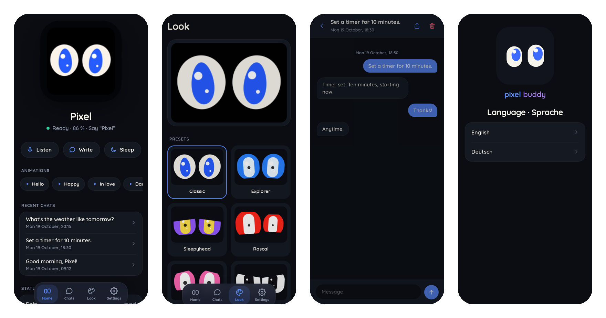
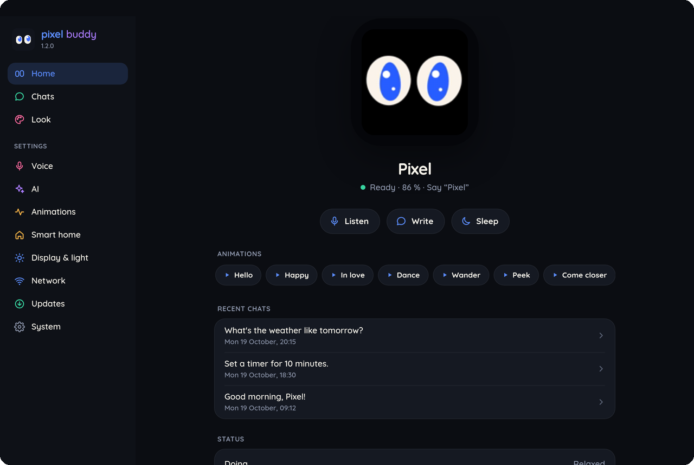
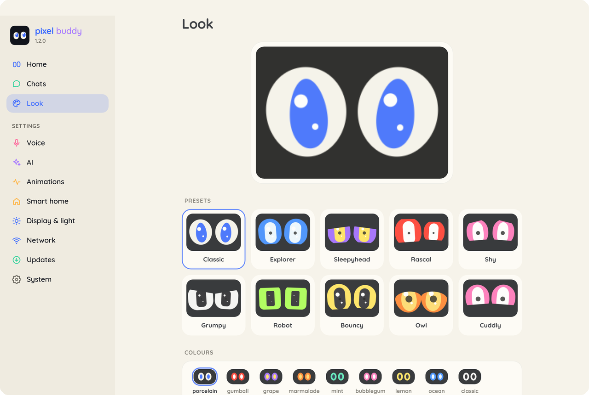
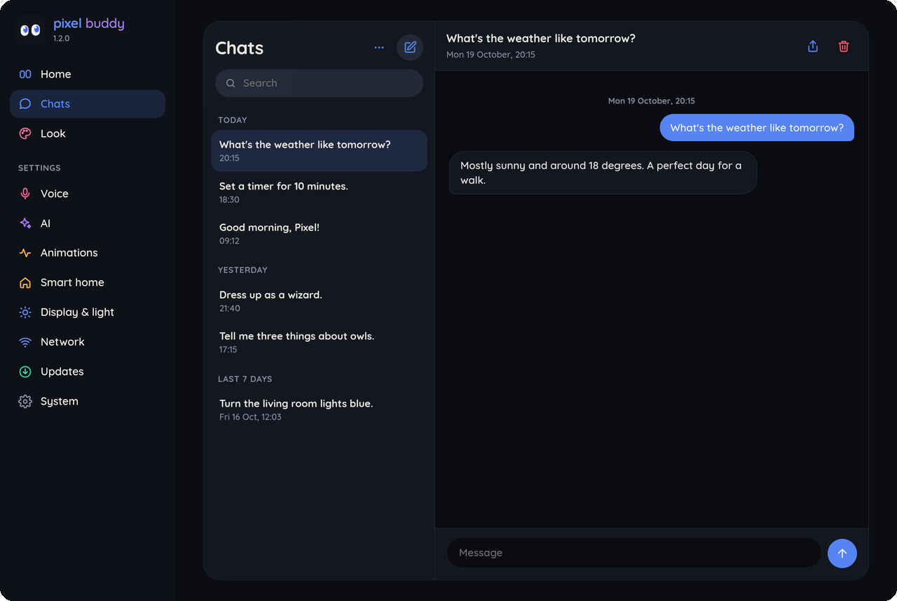

<b>A little buddy with big eyes.</b>

# Pixel Buddy

Firmware for the Spotpear ESP32-S3 "muma" board (1.54″ 240×240 touch display, microphone, speaker, microSD).
Pixel has hand-rendered eyes, wakes up when you say his name (offline, on the board) and talks live through
OpenAI (GPT-Live or the Realtime API) – in English or German.

All eye images come from the simulator (`sim/`), which uses the same renderer as the display.

**Ten presets** – face, colours and temperament in one tap, then fine-tune everything under Look:

**Symbols in his eyes** – WiFi, usage limit, battery, lights, timers, alarms, weather, questions:

**The app** at http://pixel.local – home, chats, look, settings. Runs on the robot, works offline:

| Home | Look | Chats |
|---|---|---|
|  |  |  |

## Install

**Ready-made firmware:** see [Releases](../../releases) – `pixel.bin` (full install, e.g. with the install page
from `tools/dist.sh` or `esptool.py write_flash 0x0 pixel.bin`) and `pixel-update.bin` (update over WiFi).

**Without a toolchain:** `tools/dist.sh` builds a firmware without private credentials plus an install page in
`dist/`. Publish the folder over https (e.g. GitHub Pages) or run `cd dist && python3 -m http.server 8000`, open
http://localhost:8000 in Chrome or Edge, plug in the board, click "Install".

**With PlatformIO:** `pio run -t upload`. Optionally copy `src/secrets.example.h` to `src/secrets.h` and fill in
WiFi and the OpenAI key to skip the setup.

## Setup

Without WiFi, Pixel opens his own network "Pixel-Setup-XXXX" and shows a QR code for it. Scan it with your
phone, then:

1. **Language** – English or Deutsch. Pixel speaks it, the app and the display use it.
2. **Intro** – three short slides, skippable.
3. **Name** – Pixel, or one of the other installed wake words (Buddy, Jarvis, Computer, Sophia, Willow, ESP).
   The name is what you say to wake him.
4. **WiFi** and **OpenAI key**.

The display then shows a second QR code with the app's address (also http://pixel.local). Name and language can
be changed later under Settings → Voice.

## Use

| | |
|---|---|
| Say his name ("Pixel", "Hey Buddy" …) | start talking; a short tone confirms |
| Tap while he talks | interrupt him |
| "stop", "be quiet", "never mind" … | end the conversation |
| BOOT | menu: Restart, Hotspot / Home WiFi, Off, Reset and the microphone (top left) – each asks once; BOOT or ✕ closes it |
| BOOT long | next colours |
| Microphone off (menu) | he hears nothing, a thin red frame shows; hold his face for 5 s to switch it back on |

By voice: change his look (colours, eye shape, lids, pupils, a whole preset – "be the robot"), LED colour, voice
and model, web search, lights (colour, brightness, white, effects) and other Home Assistant devices, timers,
alarms, reminders, "remember that …", weather, status, night mode, "go to sleep", "stop listening" (until the
next touch). Restart, switch off and forgetting chats only when you ask for exactly that.

Pixel knows himself: his name, wake word, look, LEDs, battery, network and what he can and can't do.

## The app

- **Home** – live view of the display, listen / write / sleep, animations, recent chats, status.
- **Chats** – every conversation as a chat: open, search, continue (Pixel remembers it), export, delete.
  Stored on the SD card, one file each (`pixel/chats/`). Nothing leaves the robot except the live conversation.
- **Look** – presets on top, then colours, eyes, pupils & iris, expression, temperament (energy, wanderlust,
  curiosity, stretch), moods, display. Save and load a look as a file. The previews are drawn by the browser
  with the same formulas as the display.
- **Settings**
  - *Voice* – name, language, voice, listening.
  - *AI* – model, web search, personality, what Pixel should know about you, OpenAI key, daily limit.
  - *Animations* – your own: up to 6 moves in a row under one name, also by voice.
  - *Smart home* – Home Assistant, mood light.
  - *Display & light* – "display off after", brightness and volume by time (up to 8 points, faded), night mode,
    LEDs, motion.
  - *Network* – change WiFi, forget WiFi (back to the setup), hotspot mode.
  - *Updates*, *System* – backup and restore, export settings, train the wake word, restart, reset.

More:
- **On the go** – in the BOOT menu, "Hotspot" connects Pixel to the network from Settings → Network → On the go,
  e.g. your phone's hotspot. Smart home answers "only at home" there; automatic updates wait until he's home.
- **Music** – with a steady beat nearby, Pixel bobs along.
- **Battery** – on Home and by voice ("how full is your battery?"); shown in his eyes when plugged in and at
  20 % / 10 %.

## Updates

Pixel fetches new versions himself from GitHub ([Releases](../../releases), file `pixel-update.bin`): every night
at 3:30 when nobody is talking to him – time and on/off under Settings → Updates. There also "Check for
updates", or ask: "Pixel, is there an update?" / "Install the update" (only on request). He backs up the settings
to the SD card first; if the new version doesn't start cleanly, he rolls back by himself.

The wake word models live in their own flash partition. After an update he checks them against the new
firmware and fetches `pixel-models.bin` from the same release if they differ.

Publish a new version: raise `PIXEL_VERSION` in `src/version.h`, commit, run `tools/release.sh`. Forks: set
`PIXEL_REPO` in `src/version.h` to your repository. WiFi and the OpenAI key from `secrets.h` are copied to internal
storage on first boot, so they survive an update from the public build.

Brand, logo, colours, type: [docs/brand.md](docs/brand.md).

## Costs

The app estimates the cost per day and month (from the API's token counts, prices in `src/config.h`) and has a
daily limit. With Realtime the session stays open between conversations (idle costs nothing), so the prompt
comes from the cache – about half the price per answer.

## Wake word

Every wake-up is recorded (2 s before, 4 s after). If someone spoke afterwards, the name is kept as
`kws/ap_*.wav` (a new training example), otherwise the recording as a false alarm `kws/fa_*.wav` – at most 800 on
the SD card. Under Settings → System → Train the wake word you can listen to them and mark them, and record your
own voice. Training on the PC: [wakeword/](wakeword/README.md).

## Code

| File | |
|---|---|
| `src/eyes.cpp` | eye engine (distance fields, springs, 40+ animations, symbols) – also in the simulator `sim/` |
| `src/live.cpp` | conversation (GPT-Live / Realtime), tools, prompts, costs |
| `src/chats.cpp` | conversations on the SD card |
| `src/mic.cpp`, `src/kws.cpp` | microphone, speaker, wake word |
| `src/net.cpp`, `src/screen.cpp` | WiFi, hotspot, setup with QR code, menu, splash |
| `src/i18n.cpp` | display texts and speech rules per language |
| `src/ha.cpp` | Home Assistant (REST + events over WebSocket) |
| `src/assist.cpp` | timers, memory, costs |
| `src/battery.cpp`, `src/beat.h`, `src/sched.h` | battery, beat detection, schedule |
| `src/web.cpp`, `web/` | the app, setup page, updates |
| `tools/fontgen.py` | the brand font (Quicksand) for display and app |
| `wakeword/` | wake word training |

**Languages:** a new language is one column in `src/i18n.cpp` (`LANGS`, `TEXT`) and one dictionary in
`web/index.html` and `web/setup.html` (`I18N`). Prompts stay English; the language is set as a variable.

**Tests on the PC:** `g++ -std=c++17 -Isrc tools/hosttest.cpp -o /tmp/hosttest && /tmp/hosttest` (guard for risky
voice commands, setup DNS, alarms across DST, schedule, beat detection, chats), `tools/facetest.sh` (faces in the
app = faces on the display), eyes in `sim/`, wake word `wakeword/check_c.py`. The build warns when `dist/` is
older than the code.

The app only accepts POST requests with `Content-Type: application/json` (protection against other websites),
e.g. `curl -H 'Content-Type: application/json' -d '{...}' http://pixel.local/api/config`.

## License

GNU Affero General Public License v3.0 (AGPL-3.0), see [LICENSE](LICENSE). If you share a modified version or offer
it over a network, you must make the source available under the same license. Dependencies (ESP-IDF, esp-sr,
esp-dl, mdns, led_strip, cJSON …) are fetched by PlatformIO / the IDF Component Manager and keep their own
licenses. The Quicksand font is under the SIL Open Font License ([fonts/OFL.txt](fonts/OFL.txt)).
