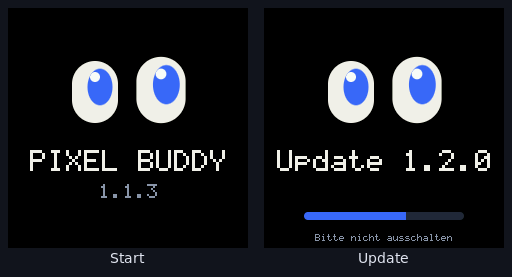

# Pixel Buddy – Marke

## Name

- **Pixel Buddy** ist das Produkt (Repository, Firmware, Installationsseite, Releases).
- **Pixel** ist der Charakter: so heißt er, so wird er gerufen („Pixel!“), so nennt er sich selbst. Wer ihn
  umbenennt, ändert nur den Charakter – das Produkt bleibt Pixel Buddy.
- Schreibweise im Text: „Pixel Buddy“, in der Wortmarke klein: „pixel buddy“.

## Slogan

> **Der kleine Freund mit großen Augen.**
> *A little buddy with big eyes.*

## Logo

Zwei Augen auf einem dunklen Bildschirm, beide schauen nach oben rechts – neugierig, nie ganz symmetrisch: das
rechte Auge ist ein kleines bisschen größer und sitzt höher (so wie Pixel selbst immer ein wenig schief schaut).

| Datei | Wofür |
|---|---|
| [`logo.svg`](logo.svg) | App-Symbol, Favicon, Avatar (quadratisch) |
| [`wordmark.svg`](wordmark.svg) | Kopfzeilen, README, Installationsseite |
| `screen.cpp` (`screen::splash`) | Startbildschirm und Update-Anzeige auf dem Display (Bild unten) |

Das Logo nicht verzerren, nicht umfärben, nicht auf unruhigen Hintergrund stellen. Mindestgröße 16 px.

## Farben

| Name | Hex | Wofür |
|---|---|---|
| Tinte | `#11141C` | Logo-Grund, dunkle Flächen |
| Nacht | `#0B0D12` | Hintergrund (Display, Webinterface dunkel) |
| Creme | `#F6F3EA` | Augenweiß, Text auf dunkel |
| Pixel-Blau | `#3D6BFF` | Iris, Wortmarke, Hauptfarbe |
| UI-Blau | `#5B8CFF` | Buttons, Links auf dunklem Grund (aufgehelltes Pixel-Blau) |
| Flieder | `#A87BFF` | „buddy“ in der Wortmarke, zweite Akzentfarbe |
| Rouge | `#FF689C` | Erröten, Herzen, Akzente |
| Mint | `#38D39F` | „alles gut“, Status ok |

**Keine Verläufe.** Flächen, Buttons, Balken und Logo sind einfarbig – flach und klar wie ein kleiner Bildschirm.

## Schrift

Die Systemschrift (system-ui / Segoe UI / Roboto) – nichts zu laden, überall gleich schnell. Wortmarke: fett
(800) mit enger Laufweite, „buddy“ normal (500). Auf dem Display: die eingebaute Pixelschrift, groß skaliert –
passend zum Namen; dort in Großbuchstaben („PIXEL BUDDY“), weil sie in 5×7 Punkten besser lesbar sind.

## Stimme

Pixel redet wie ein guter Kumpel: per du, warm, kurz, gern mit Witz – nie belehrend, nie kindisch. Texte im
Webinterface folgen dem: kurze Sätze, Alltagsdeutsch, sagen was passiert („Pixel hört zu“, „Gespeichert ✓“).
Fehler erklärt er mit den Augen statt mit Fehlermeldungen.

## Bilder

Bilder der Augen kommen aus dem Simulator (`sim/`, derselbe Renderer wie das Display) – siehe `docs/`. Dunkler
Hintergrund, die Augen groß, keine Rahmen um den Bildschirm herum erfinden.
